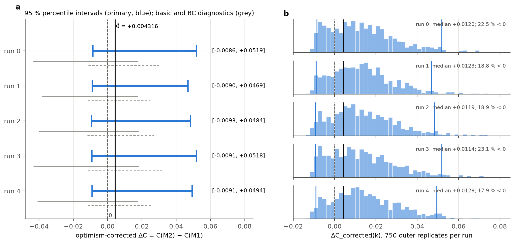

# What do cancer pathway scores really measure? A colon-cancer recurrence study and the `pathway-audit` tool

Gene-set ("pathway") scores are widely read as tumour biology and used as prognostic features. This project tested four of them rigorously in colon cancer, found what they actually track in bulk tumour tissue, replicated that across four cohorts, and turned the checks into a tested Python tool, **`pathway-audit`**, that anyone can run before interpreting a pathway score.

**Skills shown:** Python (pandas, NumPy, SciPy, scikit-learn, scikit-survival, lifelines) · R (survival) · survival analysis and optimism-corrected validation · machine learning (elastic-net Cox and logistic regression, random forest, strictly nested cross-validation, calibration, independent-cohort evaluation) · GEO microarray and TCGA RNA-seq data · tissue-composition estimation (ESTIMATE, MCP-counter) · Python packaging, command-line tools, pytest · reproducible, audited pipelines.

## At a glance

| | |
|---|---|
| **Tool** | [`tools/pathway-audit/`](tools/pathway-audit/): a tested Python package and command-line tool that audits any pathway score (data-quality gate, gene drivers, tissue composition, genotype confounding, random-set null, survival screen), with self-contained HTML reports and a 30-second built-in demo, plus a single-cell source check (`sc-sources`). 13/13 tests pass; lint-clean; CI passes on Python 3.10 and 3.12 |
| **Replicated finding** | In bulk tissue the Hallmark **EMT score tracks stromal (fibroblast) content**: gene-disjoint ρ 0.94–0.98 in GSE39582, GSE41258, GSE143985 and TCGA-COAD, each above its own random-gene-set baseline. **Confirmed in single cells** (3 public cohorts, registered before analysis): EMT-set transcripts come mainly from stromal cells (5.1× the expression-matched share; epithelial 0.45×), and no coherent tumour-cell EMT programme was detected (not ruled out) |
| **Molecular anchoring** | The **p53 score tracks TP53 mutation**, replicated in GSE41258 and TCGA-COAD and robust to hypermutation. The BRAF–p53 link in GSE39582 was explained by MMR status and composition, and both BRAF effects in TCGA were explained by hypermutation |
| **Data-quality catch** | One public cohort (GSE103479) fails a positive-control co-expression check; its values appear misaligned to probe IDs |
| **Predictive test** | In 452 stage II–III colon cancers, adding the four scores (EMT, E2F, Wnt/β-catenin, p53) to clinical variables gave no reproducible improvement: optimism-corrected ΔC **+0.0043**, all five nested-bootstrap 95 % intervals include zero |
| **Machine learning (Phase 10)** | **Recurrence:** an elastic-net Cox model over 2,000 genes kept no genes and matched the clinical model (cross-validated ΔC **+0.0003**). **MMR/MSI classification:** an elastic-net classifier trained on GSE39582 and frozen before TCGA labels were read reached TCGA-COAD AUROC **0.990** (95 % CI 0.965–1.000; 97 patients, 20 MSI-H), 0.104 above MLH1 alone. See [Phase 10](#phase-10-machine-learning-upgrade) |
| **Rigour** | Pre-specified estimand; hash-frozen pipeline; verifier 60/60; follow-up plans registered before running; independent code re-checks within the project of the primary result, the extensions and the TCGA analysis |

```bash
pip install -e tools/pathway-audit && pathway-audit demo --out demo/    # writes demo/report.html; recovers four planted truths
```

**Website:** [https://akula-prasad.github.io/pathway-score-audit-crc/](https://akula-prasad.github.io/pathway-score-audit-crc/) (interactive overview) · **Slides:** [PDF](https://akula-prasad.github.io/pathway-score-audit-crc/GSE39582_recurrence_portfolio.pdf)

Start here: [`portfolio/README.md`](portfolio/README.md) (overview, presentation, web page) · [`docs/FINAL_RESEARCH_CONTRIBUTION.md`](docs/FINAL_RESEARCH_CONTRIBUTION.md) · [`docs/manuscript/MANUSCRIPT_DRAFT.md`](docs/manuscript/MANUSCRIPT_DRAFT.md)

## Five-minute tour for reviewers

1. **The tool:** `tools/pathway-audit/README.md`, then run the demo (one command above) and open `demo/report.html`.
2. **The science in one page:** `docs/FINAL_RESEARCH_CONTRIBUTION.md`, or the draft paper `docs/manuscript/MANUSCRIPT_DRAFT.md`. Newest result: `docs/SINGLE_CELL_RESULTS.md`.
3. **The code:** the tool's package `tools/pathway-audit/src/pathway_audit/` and the nested-bootstrap engine `src/phase9_corrected/`.
4. **The evidence trail:** `docs/README.md` maps every document; `scripts/README.md` maps every script.
5. **The slides:** `portfolio/presentation/GSE39582_recurrence_portfolio.pdf`.

## Project status

- **Scientifically complete:** the frozen verification passed (60 of 60 checks), and an independent re-implementation within this project reproduced every reported number from the raw checkpoints (not an external replication).
- **Licence:** MIT (`LICENSE`), chosen by the owner on 8 November 2026. **Public release:** pending the owner's review of per-sample data governance (`docs/PUBLIC_RELEASE_REPRODUCIBILITY_AUDIT.md`).

## Phase 10: machine-learning upgrade

Post-hoc and exploratory; Phase 9 is frozen and unchanged (27/27 frozen files and 52/52 archive hashes verified by the tests). Methods and model card: [`docs/PHASE10_METHODS_AND_MODEL_CARD.md`](docs/PHASE10_METHODS_AND_MODEL_CARD.md). Results, generated from `reports/phase10/`: [`docs/PHASE10_RESULTS.md`](docs/PHASE10_RESULTS.md).

**Shared design:**
- Saved, hashed patient-level folds: 5-fold × 10 repeats.
- **Strict nesting:** the top-2,000 variance filter, scaling, pathway scores and spline knots are refit inside every inner-training fold.
- Identical folds and comparable pairs for every model.
- Repeat SDs describe partition variability; they are not confidence intervals.

**Track A, recurrence (452 patients, 136 events; cause-specific hazard):**

| Model | Harrell C (within-fold pooled, mean of 10 repeats) |
|---|---|
| M1 clinical Cox | 0.5998 |
| M2 clinical + 4 pathways (strict) | 0.6026 |
| M3 elastic-net Cox (clinical unpenalised + 2,000 genes) | 0.6000 |

- M3 kept **0 genes in all 50 outer fits**, so the transcriptome added no recurrence discrimination this design could detect.
- A training-fold permutation null gave C 0.503, with no leakage alarm.
- These are not comparable with Phase 9's optimism-corrected values (0.6016 / 0.6059), which are a different estimand.

**Track B, MMR/MSI-associated classification.** This is a positive control: strong, known biology.

| Model | GSE39582 CV AUROC (likely biased upward) | TCGA-COAD AUROC (95 % CI) |
|---|---|---|
| Elastic-net logistic | 0.992 | **0.990** (0.965–1.000) |
| Random forest | 0.987 | 0.980 (0.950–1.000) |
| MLH1 only | 0.860 | 0.886 (0.773–0.974) |
| Clinical only (age, sex, stage, location) | 0.750 | 0.773 (0.679–0.857) |

Caveats to read alongside these numbers:
- **ComBat:** GSE39582's deposited expression was ComBat-corrected with MMR status protected, so its CV metrics are likely inflated.
- **TCGA evaluation:**
  - The models were frozen and committed before any TCGA label was read.
  - It's an independent-cohort, cross-platform evaluation (Affymetrix → Illumina GA RNA-seq).
  - The labels are related but not identical PCR-MSI calls.
  - Expression was z-scored within TCGA (unsupervised target-cohort adaptation), so it isn't a single-patient prediction pipeline.
- **Declared deviation:** the pre-registered HiSeq evaluation had labels for only 4 of 182 patients. It is reported as non-informative and was replaced by a registered GA-platform evaluation.
- **Not a clinical tool.**

```bash
python3.13 -m venv ~/.venvs/coad-phase10 && ~/.venvs/coad-phase10/bin/pip install -r requirements-phase10.txt
P=~/.venvs/coad-phase10/bin/python
$P -m pytest tests/phase10 -o addopts="" -q      # 21 safeguard tests
$P -m phase10.mmr --repeats 10 && $P -m phase10.recurrence --repeats 10 --null 5
$P -m phase10.report && $P -m phase10.site       # results doc, figures, website section
```

## Research question

Does adding reproducible transcriptomic pathway information improve recurrence-risk prediction beyond clinical characteristics? Are any improvements stable enough to be statistically and biologically credible?

Recurrence risk after surgery for stage II–III colon cancer varies widely, and better risk discrimination could in principle inform decisions about adjuvant chemotherapy; this study does not show such utility. Expression signatures are often reported to add prognostic value in colorectal cancer, but part of an apparent gain is optimism: a larger model fits its own data better than new patients. This project therefore:
- fixes a small, biologically motivated panel before looking at outcomes;
- corrects for optimism;
- puts an interval on the corrected gain, so that both its size and its stability are measured.

## Main findings

> Conditional on the observed 136 recurrence events and 316 censored observations in the 452-patient A-19 population.

| | |
|---|---|
| Optimism-corrected C | M1 (clinical) **0.6016**; M2 (clinical + 4 pathways) **0.6059** |
| ΔC_corrected (pre-specified point estimate) | **+0.0043** |
| 95 % percentile intervals, five runs differing only in random seed (B_out = 750, B_in = 100) | [−0.0086, +0.0519] · [−0.0090, +0.0469] · [−0.0093, +0.0484] · [−0.0091, +0.0518] · [−0.0091, +0.0494] |
| Run-to-run SD of the interval endpoints | 0.00025 (lower), 0.00217 (upper) |
| Pathway hazard ratios, primary four-set model (per SD of score) | E2F 0.91, EMT 1.07, Wnt 1.02, p53 1.00; every 95 % CI includes 1. In the five-set sensitivity model only, E2F is 0.86 (0.75–0.996), with correlated scores; not a primary finding |
| Corrected calibration slope | M1 0.83, M2 0.86 (residual overfitting) |
| Reliability | no hard failure. Warnings: the bootstrap distribution sits above the point estimate (z₀ ≈ −0.5), and the percentile and basic intervals diverge |

**Interpretation:**
- Adding the four pathway scores was **not shown** to improve discrimination. The data are compatible with no gain and with a gain of up to about 0.05 in C.
- All percentile, basic and bias-corrected intervals include zero. That does not establish equivalence.
- No pathway shows an independent association with recurrence in the primary model (hazard ratios measure association; added discrimination is the ΔC above).
- E2F (< 1) and EMT (> 1) keep consistent directions, but neither is demonstrated here. EMT > 1 is consistent with reports that stromal/mesenchymal expression marks poor-prognosis colorectal cancer (Guinney 2015, whose subtype derivation included GSE39582; Calon 2015; Isella 2015); registered follow-up analyses later showed that the Hallmark EMT score tracks estimated stromal content in four cohorts (`docs/FINAL_RESEARCH_CONTRIBUTION.md`). Evidence on proliferation and outcome is mixed (Anjomshoaa 2009; Luo 2019). Pathway scores are averaged mRNA levels, not measures of pathway activation, protein activity or mutation status. Full references: `docs/SCIENTIFIC_RESULTS_AND_FIGURES.md` §14.
- The corrected ΔC is stable across Monte Carlo runs and expression representations. Molecular coefficients are not stable across processing batches: leaving out one batch at a time changes the sign of the Wnt and p53 coefficients. Batch effects are characterised, not resolved.
- A historical "paired out-of-original" ΔC interval that narrowly excluded zero is a different quantity, not an interval for the corrected ΔC, and it included zero under the alternative expression representation.
- There is no claim of clinical utility, absolute-risk prediction, external validity, transportability or causal mechanism.

**Full report:** `docs/PHASE9_CORRECTED_FINAL_REPORT.md`. **Illustrated results (9 main and 2 supplementary figures):** `docs/SCIENTIFIC_RESULTS_AND_FIGURES.md`. **Portfolio overview, presentation and diagrams:** `portfolio/README.md`.



## Data, cohort and endpoint

| | |
|---|---|
| Dataset | GEO GSE39582 (Marisa et al., *PLoS Med* 2013): 585 Affymetrix HG-U133 Plus 2.0 arrays, deposited as RMA + ComBat |
| Cohort | 453 stage II–III colon tumours with recurrence follow-up. QC retained all of them |
| Analysis population | 452 patients with complete clinical covariates: 136 recurrences, 316 censored |
| Endpoint | cause-specific recurrence as deposited. Deaths without recurrence are censored, and the recurrence-time unit is undocumented, so only rank-based quantities (C, hazard ratios) are reported |
| Expression representation | gene level, median of uniquely mapped probes (primary); representative-IQR probe (sensitivity). Ambiguous and unmapped probes excluded |

## Methods

- **M1:** Cox model with age (restricted cubic spline), sex, TNM stage, tumour location and adjuvant chemotherapy.
- **M2:** M1 plus four frozen MSigDB Hallmark scores (E2F targets, EMT, p53, Wnt/β-catenin; 607 genes). Each score is the mean of training-fold-standardised member genes, then standardised again. The molecular block carries a ridge penalty, with λ tuned by five-fold event-stratified cross-validation.
- **No leakage:** every estimated quantity (spline knots, gene scaling, score scaling, λ) is re-estimated inside every fit from that fit's training data.
- **Estimand:** ΔC_corrected = C_corrected(M2) − C_corrected(M1), using Harrell's bootstrap optimism correction.
- **Interval (nested bootstrap):**
  ```
  for k in 1..B_out:                       outer: event-stratified bootstrap D*_k
      fit M1, M2 on D*_k                   -> apparent ΔC(k)
      for b in 1..B_in:                    inner: bootstrap of D*_k, evaluated on D*_k
          fit M1, M2 (paired)              -> optimism(M, k, b)
      ΔC_corrected(k) = ΔC_app(k) − mean_b[opt(M2) − opt(M1)]
  interval = 2.5th and 97.5th percentiles, in each of five runs (differing only in random seed)
  ```
- **Monte Carlo control:** kernel quantile SE at three bandwidths. B_out grows along a fixed ladder until the endpoint SE is ≤ 5 % of the width (EP-1). Here 500 was topped up to 750.

## Validation and audit

- **Internal validation only.** No external validation was performed. The CIT partition of GSE39582 is confounded with batch and has 29 events, so it is not an external test.
- **Corrected pipeline** (`src/phase9_corrected/`). It fixes a random-stream deviation in an earlier run, where cross-validation reused the bootstrap resample's random state, and calls the original fitting code unchanged.
- **Code identity:** 27 source files are frozen by SHA-256, with a launcher that checks them before Python starts.
- **Execution integrity:** a pre-execution gate, append-only hash-linked checkpoints, and crash-consistent invocation records.
- **Frozen post-run verifier** (`scripts/43`): PASS, 60/60.
  - It regenerates every resample (3,750 outer, 375,000 inner) and checks stream assignment.
  - It recomputes the sizing decisions.
  - It recomputes 20 replicates bit for bit.
- **Independent audit** (`scripts/48`, standard library only): it rebuilt every interval quantity from raw checkpoint bytes and matched the official results within 2.2×10⁻¹⁶ (`reports/phase9/independent_audit/`).
- **Point-estimate alignment:** shown in `docs/PHASE9_THETA_ALIGNMENT_AUDIT.md`.

## Limitations

- **Single cohort, single platform:** internal validation only.
- **Few events:** 136 events limit precision.
- **Batch:** processing batch is confounded with the data partition, and molecular coefficients are unstable across batches; batch was examined but not perturbed.
- **Endpoint (U1, U2):** the recurrence-time unit is undocumented, and deaths without recurrence (10 %) are censored, which is informative. The models estimate the cause-specific recurrence hazard, not the cumulative incidence of recurrence (competing-risk analysis) or composite disease-free survival. No absolute-risk or calibration-in-the-large analysis is possible while the time unit is undocumented, and no competing-risk analysis was performed.
- **Discrimination and calibration measures:** the C-index reflects ranking only and says nothing about clinical usefulness; no decision-curve or reclassification analysis was done. Calibration is assessed only by log-hazard slopes.
- **Modelling:** only the molecular block is penalised, so the comparison is conservative by design. Overfitting is visible even in the clinical model (about 13.6 events per M2 coefficient).
- **Bootstrap bias:** diagnostics are triggered in every run, in the opposite direction to the protocol's anticipated mechanism, and are unexplained.
- **Partly historical:** calibration, the representation sensitivity (S-7) and the five-set sensitivity panel come from the earlier single-layer execution and were not re-run under the corrected streams.

## Repository layout

| Path | Contents |
|---|---|
| `src/phase9_execution.py`, `src/pathway_scoring.py`, `src/score_standardisation.py` | model pipeline and pathway scoring (frozen) |
| `src/phase9_corrected/` | nested-bootstrap engine, random streams, checkpointing, orchestration, statistics, gate, verification |
| `scripts/01`–`14` | data download, metadata and probe audits, probe cache |
| `scripts/15`–`39` | Phases 1–9: cohort, gene mapping, bundle, QC, EDA, protocol, Phase 9 primary execution (`38`) and S-7 (`39`) |
| `scripts/40`–`48` | as-run nested driver (historical), corrected driver (`41`), launcher (`42`), verifier (`43`), freeze tooling (`44`), sizing writer (`45`), gated report (`46`), θ̂ alignment check (`47`), independent audit (`48`) |
| `config/analysis/`, `config/pathways/` | run configuration with owner decisions, freeze record, QC and amendment records, frozen pathway panels |
| `docs/` | phase reports, protocols (`PHASE9_MODELING_PROTOCOL_DRAFT.md` v3.1, `PHASE9_DELTAC_INTERVAL_PLAN.md` v2.1), audits, final report |
| `reports/phase9/corrected_rerun/` | corrected campaign: checkpoints, invocation records, gate evidence, sizing, verification reports |
| `reports/phase9/corrected_rerun_report/` | final interval results (JSON) and tables |
| `reports/phase9/independent_audit/` | independent audit results and report |
| `reports/phase9/execution*/`, `dc_interval/`, `final_project/` | historical Phase 9 outputs, kept unchanged; the as-run intervals are superseded |
| `scripts/exploratory/` | registered post-hoc analyses X1–X9 (`run_all.sh`; validation 22/22) |
| `scripts/research_extensions/` | research extensions E1–E3 and the TCGA addendum (`run_all.sh`; validation 28/28) |
| `reports/exploratory/`, `reports/research_extensions/`, `results/research_extensions/`, `figures/research_extensions/` | outputs of the post-hoc work |
| `scripts/single_cell/`, `results/single_cell/`, `figures/single_cell/` | registered single-cell extension S1–S5 (`run_all.sh`; validation 16/16) |
| `tools/pathway-audit/` | the reusable tool: package, CLI, tests, demo and case-study scripts (bulk and single-cell) |
| `reports/pathway_audit_case_study/` | tool reports for five colorectal cohorts |
| `portfolio/` | presentation, web page, diagrams, resume text and portfolio QC |
| `tests/` | 1,097 tests (`conftest.py` skips the 176 data-dependent ones when the data are absent) |

## Environment

- **Python:** 3.13.13 with NumPy 2.5.4, pandas, lifelines, SciPy, pyarrow and pytest. The exact versions are in `requirements.txt` (original capture) and `requirements-analysis.txt` (additions).
- **Platform:** macOS arm64. The freeze record pins the environment fingerprint, including the BLAS/LAPACK build, and the launcher needs system `jq` and `shasum`.

```bash
python3.13 -m venv .venv
.venv/bin/python -m pip install -r requirements.txt -r requirements-analysis.txt
.venv/bin/python -m pytest -q tests/
```

**Without the data** (a fresh clone): 909 tests pass and 188 are skipped. The 176 tests that need the gitignored data bundle are listed in `tests/data_dependent_tests.txt`, and `tests/conftest.py` skips them with a stated reason. **With the data** (after the pipeline below): all 1,097 tests pass and none are skipped.

`pathway-audit` has its own suite: `cd tools/pathway-audit && pip install -e ".[survival,test]" && pytest` (13 tests, no project data needed; also run by GitHub Actions on every push).

## Reproduction

1. **Data** (public, about 356 MB): `scripts/01_download_geo.py` and `scripts/09_download_gpl570_annotation.py`. Then build the caches and the analysis bundle with scripts 13, 16–23 in order. `data/raw/CHECKSUMS.sha256` and the manifests pin every input.
2. **Historical Phase 9 primary estimate:** `scripts/38_phase9_execute.py`.
3. **Corrected campaign:** see `docs/PHASE9_DECISION13_FREEZE_PROCEDURE.md`.
   ```bash
   unset OMP_NUM_THREADS MKL_NUM_THREADS OPENBLAS_NUM_THREADS VECLIB_MAXIMUM_THREADS NUMEXPR_NUM_THREADS
   CFG=config/analysis/PHASE9_CORRECTED_RUN_CONFIG_OWNER_BLANK.json
   for r in 0 1 2 3 4; do scripts/42_phase9_corrected_launch.sh run $CFG $r 500; done
   # a top-up beyond 500 requires the sizing decision (scripts/45) and an explicit authorisation reference
   scripts/42_phase9_corrected_launch.sh verify $CFG
   P=$(mktemp -d); .venv/bin/python -I -B -X pycache_prefix=$P scripts/46_phase9_corrected_report.py $CFG <out_dir>
   python3 -I -B scripts/48_phase9_independent_audit.py <audit_dir>
   ```
   One run takes about 3–5 h at 500 replicates on 8 cores.

**Without re-running, from the archived checkpoints:**
- restore the archive (below);
- run the verifier, the report tool and the independent audit. These recompute every reported number in under an hour.

## Checkpoint archive

The five corrected checkpoints (113 MB each) exceed GitHub's 100 MB file limit.
- `reports/phase9/ARCHIVE_MANIFEST_SHA256.txt` pins all 52 campaign files.
- `docs/LARGE_ARTIFACT_ARCHIVE.md` gives the archive, restore and integrity-check commands:
  ```bash
  shasum -a 256 -c reports/phase9/ARCHIVE_MANIFEST_SHA256.txt
  ```

The archive destination is pending the owner's decision.

## Data access and licensing

- **GSE39582:** public GEO data. Cite Marisa L. et al., *PLoS Med* 2013;10:e1001453, doi:10.1371/journal.pmed.1001453. Raw and processed data are not redistributed here: download them from GEO.
- **Hallmark gene sets:** from MSigDB (Liberzon et al., *Cell Syst* 2015;1:417–425, doi:10.1016/j.cels.2015.12.004). Use is subject to MSigDB's terms. The panel files record set identifiers and resolved members.
- **Code licence:** MIT (`LICENSE`). It covers the code and documentation written for this project. Third-party data, gene sets and reference files keep their own terms and are not redistributed, except the resolved Hallmark gene-set members recorded in the panel files.
