# Scientific results and figures — GSE39582 recurrence study

**Date:** 8 November 2026. **Relationship to other documents:** this is the illustrated results presentation. The source of record for every number and conclusion remains `docs/PHASE9_CORRECTED_FINAL_REPORT.md` (FR). Nothing here changes a result. All figures were produced by `scripts/49_make_results_figures.py` from frozen outputs only, with no model refitted.

**Figure files:** `reports/figures/final/` (SVG and PNG). Full captions are in `reports/figures/final/FIGURE_CAPTIONS.md`, every plotted number is in `figure_values.json`, and input hashes are in `figure_sources.json`.

> All results are conditional on the observed 136 recurrence events and 316 censored observations in the 452-patient A-19 population.

---

## 1. Question

Does adding reproducible transcriptomic pathway information (four frozen MSigDB Hallmark scores) improve recurrence-risk discrimination beyond clinical characteristics? Is any improvement stable enough to be statistically and biologically credible?

## 2. Cohort and endpoint (Figure 1, Figure S2)

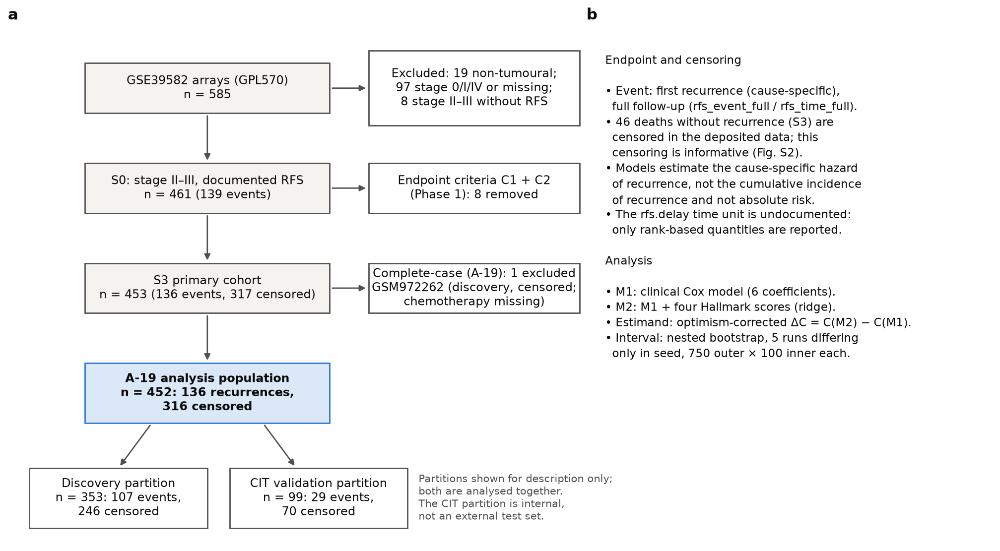

**Cohort selection.**

| Step | Patients | Events / censored |
|---|---:|---|
| GSE39582 arrays | 585 | — |
| S0: stage II–III with documented RFS | 461 | — |
| S3 primary cohort | 453 | 136 / 317 |
| **A-19 analysis population** | **452** | **136 / 316** |

**Partition counts within A-19** (descriptive, from the frozen partition labels; not a separate validation):

| Partition | Patients | Events | Censored |
|---|---:|---:|---:|
| Discovery | 353 | 107 | 246 |
| CIT validation | 99 | 29 | 70 |

- The only A-19 exclusion, GSM972262 (CIT306), is a censored discovery-partition patient with missing adjuvant-chemotherapy status. So the CIT partition is identical in S3 and A-19 (99 patients, 29 events).
- The CIT partition is internal and confounded with processing batch. It is not an external test set, and both partitions are analysed together.

**Endpoint.** Cause-specific recurrence: the models estimate the **cause-specific hazard** of recurrence. That is neither the absolute probability of recurrence nor its cumulative incidence.
- **Informative censoring.** The 46 deaths without recurrence (S3) are censored in the deposited data, and that censoring is informative (Figure S2). Those patients were older (median 75.0 vs 68.0 years), less often stage III (32.6 % vs 38.7 %) and less often treated with chemotherapy (23.9 % vs 42.1 %).
- **Time unit.** The `rfs.delay` unit is undocumented, so only rank-based quantities are reported.

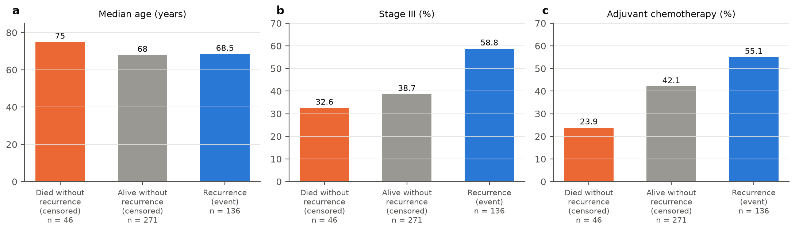

## 3. Expression preprocessing and QC (Figure 2)

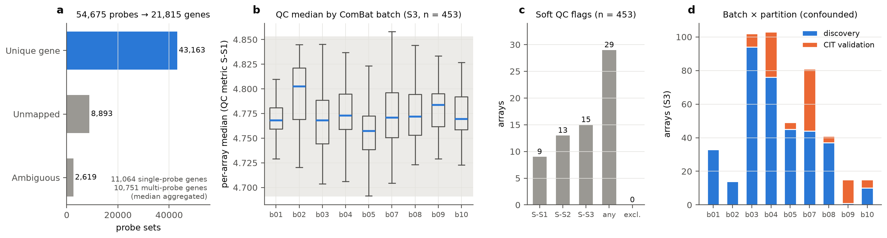

- **Probe mapping.** Of 54,675 GPL570 probe sets:
  - 43,163 map to one gene symbol and are used;
  - 8,893 are unmapped and excluded;
  - 2,619 are ambiguous and excluded.

  This gives 21,815 genes, of which 10,751 have several probe sets and are summarised by the median.
- **Matrix.** The deposited RMA + ComBat matrix was used without further normalisation.
- **QC.** 29 of 453 arrays carry soft flags (median, IQR or correlation fences), and none was excluded, because no independent technical evidence of invalidity was found.
- **Batch.** Processing batch is confounded with the discovery/CIT partition (Fig. 2d).

## 4. Exploratory expression structure (Figure 3)

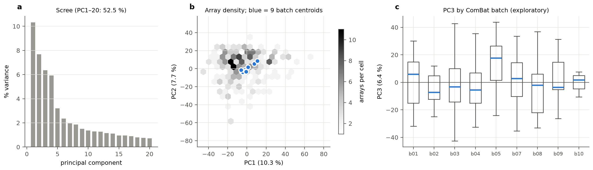

- PC1–20 explain 52.5 % of the variance (PC1 10.3 %, PC2 7.7 %).
- Batch centroids lie close together in PC1–PC2.
- PC3 differs between batches (most visibly batch05). Phase 8B quantified this as an association (ε² = 0.061).
- These are **exploratory** observations. They show residual batch-associated structure, not a demonstrated technical effect on outcome.

## 5. Pathway-score characterisation (Figure 4)

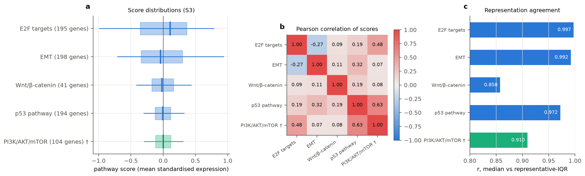

**What a score is.** Each score is the mean of standardised member-gene mRNA levels. It summarises expression, and it is **not** a measure of pathway activation, protein activity or mutation status.

| Pathway | Genes | Panel |
|---|---:|---|
| E2F targets | 195 | primary |
| EMT | 198 | primary |
| Wnt/β-catenin | 41 | primary |
| p53 pathway | 194 | primary |
| PI3K/AKT/mTOR | 104 | sensitivity only |

**Correlations among scores.** Most are modest. p53 ↔ PI3K (r = 0.63) and E2F ↔ PI3K (r = 0.48) are the strongest, and both involve the sensitivity-only PI3K score.

**Median vs representative-IQR agreement.** Agreement is high (r = 0.858–0.997). It is lowest for Wnt (r = 0.858).

## 6. Clinical model M1 (Figure 5)

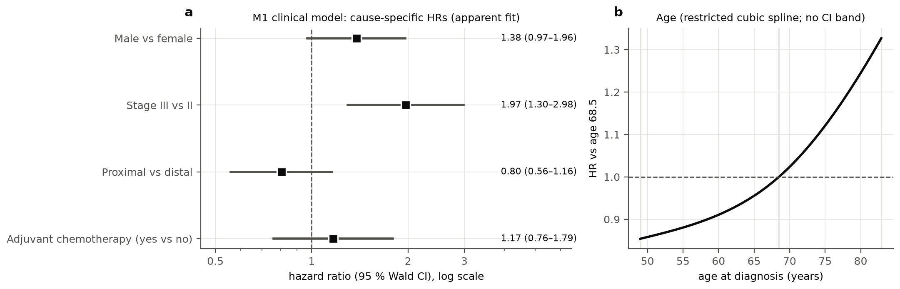

Adjusted **cause-specific** hazard ratios from the apparent fit, with 95 % Wald CIs:

| Covariate | HR (95 % CI) |
|---|---|
| Stage III vs II | 1.97 (1.30–2.98) |
| Male vs female | 1.38 (0.97–1.96) |
| Proximal vs distal tumour | 0.80 (0.56–1.16) |
| Adjuvant chemotherapy (yes vs no) | 1.17 (0.76–1.79) |

- **Chemotherapy.** Its HR is confounded by indication and has no causal reading.
- **Age.** Age is modelled with a restricted cubic spline, so it has no single HR. Fig. 5b shows the stored spline relative to age 68.5. No band is drawn, because the coefficient covariance was not stored.
- **Association, not discrimination.** Hazard ratios measure association. They do not measure how much a covariate improves discrimination; that is ΔC (section 9).

## 7. Primary molecular model and sensitivity models (Figure 6; historical single-layer estimates)

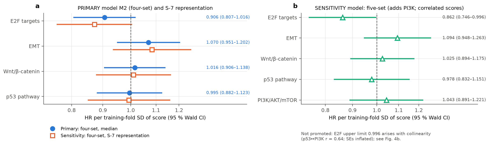

**Primary model (four-set M2, median representation, λ = 0.351).** HR per training-fold SD of each score (FR §9):

| Pathway | HR (95 % CI) |
|---|---|
| E2F targets | 0.906 (0.807–1.016) |
| EMT | 1.070 (0.951–1.202) |
| Wnt/β-catenin | 1.016 (0.906–1.138) |
| p53 pathway | 0.995 (0.882–1.123) |

**Every interval includes 1.** No pathway shows an independent association with recurrence. Intervals from a ridge-penalised fit are approximate.

**S-7 representation (sensitivity).** Same directions, with every interval including 1. This re-summarises the same arrays for the same patients, so it is **not independent replication**.

**Five-set model (sensitivity, adds PI3K).**
- E2F is 0.862 (0.746–0.996), narrowly excluding 1.
- This coincides with collinearity: p53 ↔ PI3K r = 0.64, and SEs inflated ×1.20–1.34.
- The panel was fixed as sensitivity-only before any fit, and its C does not differ from the primary model. The result is **not promoted** to a primary finding (FR §9.1).

## 8. Predictive performance (Figure 7; full-data point estimates that define θ̂; the interval for ΔC is in §9)

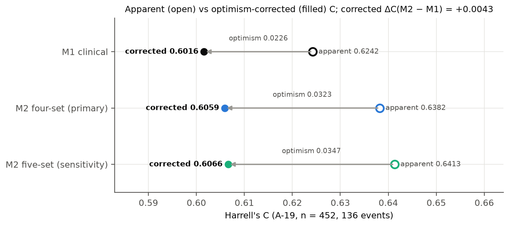

| Model | Apparent C | Optimism-corrected C | Optimism |
|---|---:|---:|---:|
| M1 clinical | 0.6242 | 0.6016 | 0.023 |
| M2 four-set (primary) | 0.6382 | 0.6059 | 0.032 |
| M2 five-set (sensitivity) | 0.6413 | 0.6066 | 0.035 |

- **The apparent advantage is mostly optimism.** M2's apparent advantage over M1 (+0.0140) is mostly optimism. The corrected difference is **+0.0043**.
- **Optimism correction is not external validation.** It estimates performance in new samples from the same population, not in other cohorts.

## 9. Corrected ΔC and its uncertainty — central result (Figure 8, Figure S1)

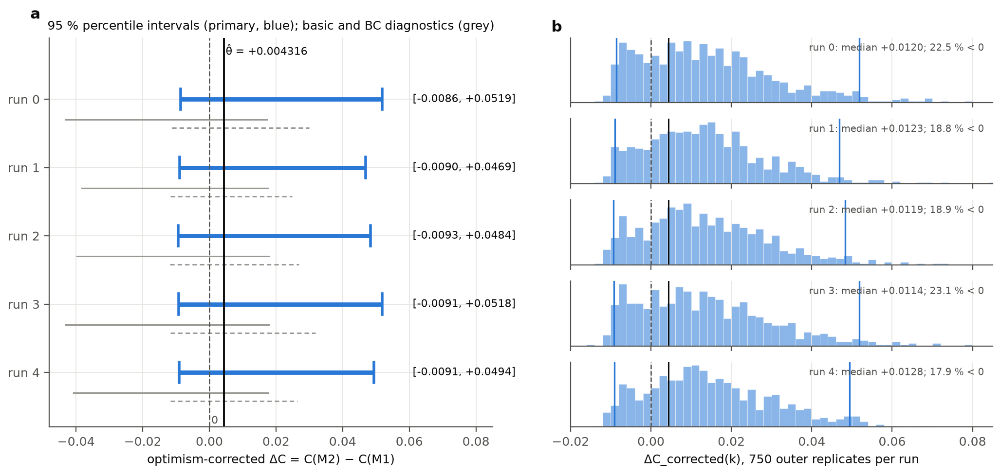

**Design.** Corrected nested bootstrap: five runs that differ **only in random seed**, so they are not independent cohorts or experiments. Each run has 750 event-stratified outer resamples × 100 inner resamples.
- Frozen verification: PASS, 60/60.
- Independently reproduced by a separate implementation within the project (`reports/phase9/independent_audit/`), not an external replication by another group or in another cohort.

**95 % percentile intervals (primary):**

| Run | Interval |
|---|---|
| 0 | [−0.0086, +0.0519] |
| 1 | [−0.0090, +0.0469] |
| 2 | [−0.0093, +0.0484] |
| 3 | [−0.0091, +0.0518] |
| 4 | [−0.0091, +0.0494] |

Point estimate: θ̂ = +0.004316. **All five intervals include zero.**

**What kind of interval this is.**
- These are **bootstrap uncertainty intervals for the optimism-corrected ΔC**. They are not Wald confidence intervals.
- They are also not the historical *paired out-of-original* intervals (FR §8.1). Those belong to a different quantity, which mixes in-sample and out-of-sample information.

**Bootstrap-bias diagnostics.** The outer distributions lie above θ̂ (about a third of replicates fall below it), and the basic and bias-corrected intervals (grey) diverge from the percentile intervals (warnings A7 and A8). The analysis does not explain this shift. All 15 interval constructions include zero, so the qualitative result does not depend on it.

**Monte Carlo precision (Figure S1).**
- EP-1 is met: the largest endpoint MC-SE is 4.2 % of the interval width.
- Endpoints vary little across seeds (between-run SD 0.00025 lower, 0.00217 upper).
- These are simulation-error quantities, not sampling uncertainty.

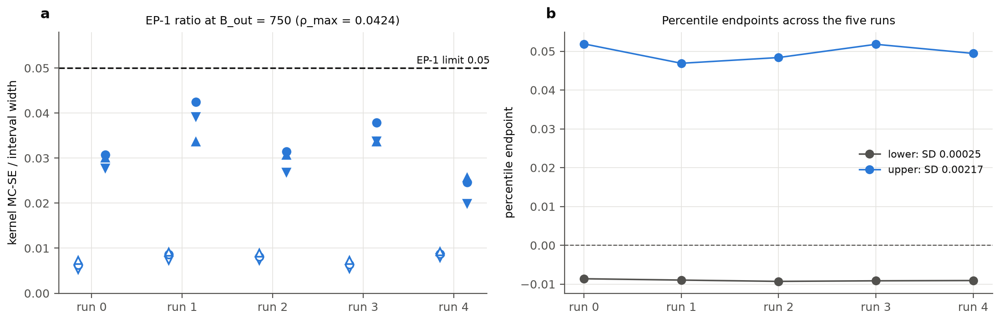

## 10. Representation sensitivity, batch robustness and calibration (Figure 9; historical single-layer estimates, descriptive)

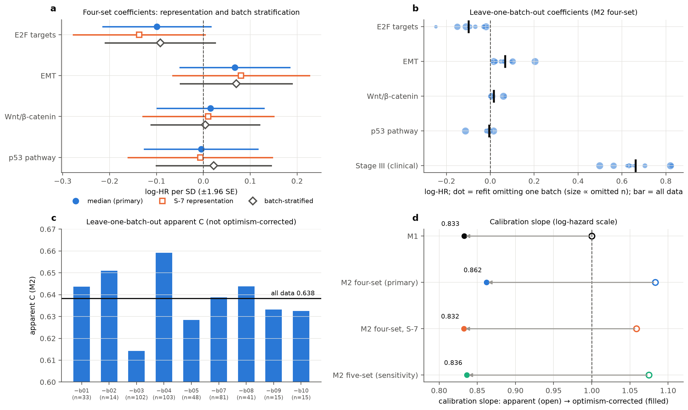

**S-7 (Fig. 9a).**
- Four-set coefficients keep their directions under the representative-IQR summary.
- Corrected ΔC is +0.0043 under both representations.
- Under S-7 the five-set model's corrected C moves beyond Monte Carlo error (0.6066 → 0.6041), and its collinearity worsens (FR §11).

**Batch (Fig. 9a–c).**
- With the nine batches as strata, the molecular coefficients barely change (Δ ≤ 0.027), but stage attenuates (HR 1.94 → 1.68).
- Leaving out one batch at a time moves the molecular coefficients several-fold, and Wnt and p53 change sign. Apparent C ranges from 0.614 to 0.659.
- The leave-one-batch-out spread partly reflects sample size, because the largest batches hold about 23 % of the cohort.
- Batch effects are **characterised, not resolved**.

**Calibration (Fig. 9d).** Optimism-corrected log-hazard slopes:

| Model | Corrected slope |
|---|---:|
| M1 | 0.833 |
| M2 (primary) | 0.862 |
| M2, S-7 | 0.832 |
| M2 five-set | 0.836 |

All are below 1, which indicates residual overfitting, even in the clinical model. Calibration-in-the-large and absolute-risk calibration cannot be assessed (undocumented time unit; informative censoring).

## 11. Biological interpretation

The background column is general colorectal-cancer literature: plausibility only, not tested here. The other columns are what this dataset shows.

| Pathway | Plausible context (literature; not tested here) | Primary HR (95 % CI) | S-7 | Batch: leave-one-batch-out range (sign changes); stratified HR | Reasonable hypothesis | Cannot be concluded |
|---|---|---|---|---|---|---|
| EMT | mesenchymal/stromal expression characterises the CMS4 subtype, which had worse relapse-free survival (R1; GSE39582 contributed to the CMS derivation, so this is not independent evidence); mesenchymal-subtype transcripts in bulk colorectal tumours are mostly stromal (R2, R3), not tested for the Hallmark EMT score | 1.070 (0.951–1.202) | 1.084 | +0.009 to +0.204 (0); 1.073 | stromal-rich tumours may recur more (R2, R3) | tumour-cell EMT vs stroma; activation; causality |
| E2F targets | proliferation and cell-cycle genes; evidence on proliferation and outcome is mixed: lower proliferation-signature expression in relapsed primary tumours (R4), but high Ki-67 associated with poorer survival in a meta-analysis (R5) | 0.906 (0.807–1.016) | 0.872 | −0.249 to −0.014 (0); 0.912 | lower proliferation may accompany higher recurrence (consistent with R4, not with R5) | an association (CI includes 1); mechanism |
| Wnt/β-catenin | Wnt-pathway genes genomically altered in about 93 % of colorectal cancers (R6); genomic alteration is not activation, and marked WNT/MYC activation characterises CMS2 specifically (R1), so Wnt-related expression varies between tumours | 1.016 (0.906–1.138) | 1.011 | −0.002 to +0.067 (1); 1.004 | none | any effect |
| p53 pathway | p53 transcriptional targets, not TP53 mutation status; TP53 is mutated in about 60 % of non-hypermutated tumours (R6), and TP53 status was not analysed here | 0.995 (0.882–1.123) | 0.993 | −0.113 to +0.014 (2); 1.022 | none | TP53 status; any effect |
| PI3K/AKT/mTOR (sensitivity) | PIK3CA mutated in about 15 % of non-hypermutated tumours (R6); gene expression is not pathway activity | 1.043 (0.891–1.221), five-set | — | — | none | any effect; it destabilises other estimates |

Coefficient values in the batch column are log-HR; the stratified values are HR.

E2F below 1 and EMT above 1 keep consistent directions. That makes them **hypotheses** consistent with part of the prior literature (EMT/stroma: R1–R3; proliferation: mixed, R4 vs R5). This dataset demonstrates neither an association nor a mechanism, and no explanation is offered for the null or unstable Wnt, p53 and PI3K results.

## 12. Limitations

- **Internal validation only.** No external validation was performed, and the CIT partition is not an external test.
- **Events.** 136 events limit precision (about 13.6 per M2 coefficient).
- **Batch confounding.** Coefficient instability across batches; batch effects not resolved.
- **Endpoint.** Informative censoring (46 deaths). Cause-specific hazard only: no cumulative-incidence, absolute-risk or competing-risk analysis. Undocumented time unit.
- **Overfitting.** Corrected calibration slopes of 0.83–0.86.
- **C-index.** It measures ranking only. No decision-curve, reclassification or clinical-utility analysis was performed.
- **Unexplained shift.** The bootstrap distribution sits above θ̂, and this is not explained.
- **Historical values.** The coefficients, calibration, S-7, five-set and batch analyses are historical single-layer estimates. Only ΔC has a verified nested interval.

## 13. Conclusion

Adding the four Hallmark pathway scores to a clinical Cox model **was not shown to improve recurrence discrimination** in this cohort.
- **Corrected gain:** +0.0043, with five seed-replicate 95 % intervals of about −0.009 to +0.05. Neither a small loss nor a modest gain can be excluded, and this does not establish equivalence.
- **Coefficients:** no pathway coefficient in the primary model is distinguishable from no effect, and the coefficients are unstable across processing batches. Both models are overfitted.
- **Biology:** the consistent E2F and EMT directions are hypotheses consistent with part of the prior literature (EMT/stroma: R1–R3; proliferation: mixed, R4 vs R5), not findings.
- **Claims not made:** clinical utility, absolute-risk prediction, external validity, transportability or causal mechanism.

---

### Figure index

| Figure | File | Section | Role |
|---|---|---|---|
| 1 | `Fig1_study_design_cohort` | 2 | design |
| 2 | `Fig2_preprocessing_qc` | 3 | descriptive |
| 3 | `Fig3_exploratory_structure` | 4 | exploratory |
| 4 | `Fig4_pathway_scores` | 5 | descriptive |
| 5 | `Fig5_clinical_model` | 6 | reference model |
| 6 | `Fig6_molecular_hazard_ratios` | 7 | primary (a) and sensitivity (a: S-7; b: five-set) |
| 7 | `Fig7_discrimination` | 8 | primary |
| 8 | `Fig8_corrected_deltaC` | 9 | **primary result** |
| 9 | `Fig9_robustness` | 10 | sensitivity / reliability |
| S1 | `FigS1_monte_carlo_precision` | 9 | method |
| S2 | `FigS2_informative_censoring` | 2 | limitation |

## 14. References

- R1. Guinney J, Dienstmann R, Wang X, et al. The consensus molecular subtypes of colorectal cancer. *Nat Med* 2015;21(11):1350–1356. doi:[10.1038/nm.3967](https://doi.org/10.1038/nm.3967)
- R2. Calon A, Lonardo E, Berenguer-Llergo A, et al. Stromal gene expression defines poor-prognosis subtypes in colorectal cancer. *Nat Genet* 2015;47(4):320–329. doi:[10.1038/ng.3225](https://doi.org/10.1038/ng.3225)
- R3. Isella C, Terrasi A, Bellomo SE, et al. Stromal contribution to the colorectal cancer transcriptome. *Nat Genet* 2015;47(4):312–319. doi:[10.1038/ng.3224](https://doi.org/10.1038/ng.3224)
- R4. Anjomshoaa A, Nasri S, Humar B, et al. Slow proliferation as a biological feature of colorectal cancer metastasis. *Br J Cancer* 2009;101(5):822–828. doi:[10.1038/sj.bjc.6605229](https://doi.org/10.1038/sj.bjc.6605229)
- R5. Luo ZW, Zhu MG, Zhang ZQ, et al. Increased expression of Ki-67 is a poor prognostic marker for colorectal cancer patients: a meta analysis. *BMC Cancer* 2019;19:123. doi:[10.1186/s12885-019-5324-y](https://doi.org/10.1186/s12885-019-5324-y)
- R6. Cancer Genome Atlas Network. Comprehensive molecular characterization of human colon and rectal cancer. *Nature* 2012;487(7407):330–337. doi:[10.1038/nature11252](https://doi.org/10.1038/nature11252)
- R7. Liberzon A, Birger C, Thorvaldsdóttir H, et al. The Molecular Signatures Database (MSigDB) hallmark gene set collection. *Cell Syst* 2015;1(6):417–425. doi:[10.1016/j.cels.2015.12.004](https://doi.org/10.1016/j.cels.2015.12.004)
- R8. Marisa L, de Reyniès A, Duval A, et al. Gene expression classification of colon cancer into molecular subtypes: characterization, validation, and prognostic value. *PLoS Med* 2013;10(5):e1001453. doi:[10.1371/journal.pmed.1001453](https://doi.org/10.1371/journal.pmed.1001453)

All references were verified on 8 November 2026 through Europe PMC (`docs/BIOLOGICAL_EVIDENCE_AND_CITATION_AUDIT.md` §1).
