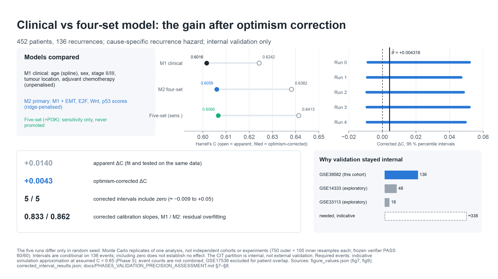

# Do tumour pathway-expression scores improve colon-cancer recurrence prediction?

A pre-specified, internally validated survival-analysis study of whether four Hallmark pathway-expression scores add recurrence-discrimination information beyond clinical variables in stage II–III colon cancer (GEO GSE39582).

## In plain terms

- **The problem.** After surgery for colon cancer, some patients' cancer comes back and others' does not, and doctors cannot fully tell in advance who is at risk.
- **The question.** Does measuring the expression of genes from four biological programmes in the tumour help predict that risk better than standard clinical information such as cancer stage?
- **The approach.**
  1. Choose the four programmes before looking at patient outcomes.
  2. Compare a clinical-only model with a clinical-plus-genes model in 452 patients.
  3. Measure how much any improvement was just the model fitting its own data.
  4. Check every number twice.
- **The result.** The gene programmes did not reliably improve prediction. Most of the apparent improvement was an artefact of fitting.
- **The limits.** The tissue samples mix cancer cells with other cell types. Processing batches affected the estimates. No second patient group was available to confirm the finding.
- **Why it matters.** The project shows how to evaluate a molecular signature honestly instead of reporting its most flattering number.

## Technical answer

- Adding the four scores to a clinical Cox model **did not demonstrate a reproducible improvement** in recurrence discrimination.
- The optimism-corrected gain in Harrell's C is **+0.004316**.
- All five corrected-bootstrap 95 % intervals include zero (about −0.009 to +0.05).
- This does not establish that the true effect is zero, or that these pathways have no biological role.

## Deliverables

| Deliverable | Audience | Path |
|---|---|---|
| Interactive research portfolio (web page source) | Everyone; start here | [`web/index.html`](web/index.html) (live at https://akula-prasad.github.io/pathway-score-audit-crc/) |
| Research report (abstract, methods, results, discussion) | Scientific reviewers | [`RESEARCH_REPORT.md`](RESEARCH_REPORT.md) |
| Presentation, 19 slides plus 2 appendix slides (editable) | Interview presentations, about 15–20 minutes | [`presentation/GSE39582_recurrence_portfolio.pptx`](presentation/GSE39582_recurrence_portfolio.pptx) |
| Presentation (PDF) | As above | [`presentation/GSE39582_recurrence_portfolio.pdf`](presentation/GSE39582_recurrence_portfolio.pdf) |
| Speaker notes | Presenter | [`SPEAKER_NOTES.md`](SPEAKER_NOTES.md) |
| Interview preparation and question bank | Interview practice | [`INTERVIEW_PREPARATION.md`](INTERVIEW_PREPARATION.md) |
| Skills evidence and role fit | Applications | [`SKILLS_EVIDENCE_AND_ROLE_FIT.md`](SKILLS_EVIDENCE_AND_ROLE_FIT.md) |
| Resume bullets and LinkedIn text (evidence-backed) | Applications | [`RESUME_AND_LINKEDIN.md`](RESUME_AND_LINKEDIN.md) |
| Reproducibility guide (tested commands) | Technical reviewers | [`REPRODUCIBILITY_GUIDE.md`](REPRODUCIBILITY_GUIDE.md) |
| Diagrams D1–D5 (SVG and PNG) | Documents | [`diagrams/`](diagrams/) |
| Slide visuals V01–V18 (original vector drawings, SVG and PNG) | The presentation | [`diagrams/slides/`](diagrams/slides/) |
| Scientific figures 1–9, S1–S2, with captions and sources | Scientific reviewers | [`../reports/figures/final/`](../reports/figures/final/) |
| Quality-control report | Verification | [`PORTFOLIO_QC_REPORT.md`](PORTFOLIO_QC_REPORT.md) |
| `pathway-audit`: tested Python command-line tool that audits what a pathway score measures (quality gate, gene drivers, composition, genotype confounding, survival screen) | Technical reviewers, anyone with bulk expression data | [`../tools/pathway-audit/`](../tools/pathway-audit/) |
| Five-cohort audit case study (GSE39582, GSE41258, GSE143985, GSE103479, TCGA-COAD) | Scientific reviewers | [`../reports/pathway_audit_case_study/SUMMARY.md`](../reports/pathway_audit_case_study/SUMMARY.md) |
| Final research contribution and manuscript draft | Scientific reviewers | [`../docs/FINAL_RESEARCH_CONTRIBUTION.md`](../docs/FINAL_RESEARCH_CONTRIBUTION.md), [`../docs/manuscript/MANUSCRIPT_DRAFT.md`](../docs/manuscript/MANUSCRIPT_DRAFT.md) |
| Limitation-resolution register (post-hoc, registered analyses) | Scientific reviewers | [`../docs/SCIENTIFIC_LIMITATION_RESOLUTION_REGISTER.md`](../docs/SCIENTIFIC_LIMITATION_RESOLUTION_REGISTER.md) |
| Scientific interpretation and conclusion | Scientific reviewers | [`../docs/SCIENTIFIC_INTERPRETATION_AND_CONCLUSION.md`](../docs/SCIENTIFIC_INTERPRETATION_AND_CONCLUSION.md) |
| Completion report | Final readiness review | [`PORTFOLIO_COMPLETION_REPORT.md`](PORTFOLIO_COMPLETION_REPORT.md) |
| Asset and source inventory | Provenance | [`ASSET_INVENTORY.md`](ASSET_INVENTORY.md) |
| Final scientific report (full audit trail) | Specialists | [`../docs/PHASE9_CORRECTED_FINAL_REPORT.md`](../docs/PHASE9_CORRECTED_FINAL_REPORT.md) |
| Technical repository README | Developers | [`../README.md`](../README.md) |



---

## Research question
Do four biologically selected tumour-expression pathway scores add reproducible recurrence-discrimination information beyond established clinical variables in GSE39582?

## Biological motivation
- After surgery for stage II–III colon cancer, a substantial minority of patients recur, and stage alone sorts that risk imperfectly.
- The panel represents four axes of colorectal-cancer biology:

  | Axis | Hallmark set | Member genes |
  |---|---|---:|
  | Initiating driver pathway | Wnt/β-catenin | 41 |
  | Proliferation | E2F targets | 195 |
  | DNA-damage checkpoint | p53 pathway | 194 |
  | Mesenchymal/stromal state (linked to the poor-prognosis CMS4 subtype) | EMT | 198 |

- Each score is the mean standardised mRNA of a fixed gene set in bulk tumour tissue. It summarises expression. It does not measure pathway activation, mutation status or the cell type the signal came from (diagram D1).

## Dataset and cohort
- **Source:** GEO GSE39582 (Marisa et al., *PLoS Med* 2013): 585 Affymetrix HG-U133 Plus 2.0 arrays, deposited as RMA + ComBat.
- **Analysis population:** 452 stage II–III patients, 136 recurrences, 316 censored.
- **Endpoint:** the **cause-specific hazard of recurrence**, not absolute recurrence probability or cumulative incidence.
  - 46 deaths without recurrence are censored in the deposit, and that censoring is informative.
  - The recurrence time unit is undocumented, so only rank-based measures (C-index, hazard ratios) are reported.
- **CIT partition:** 99 patients, 29 events. It is internal validation, not external validation.

## Computational workflow and feature engineering
1. **Probes to genes:** 54,675 probe sets → 43,163 map to a single gene → 21,815 unique genes (median of probes per gene). A representative-probe alternative (S-7) is a frozen sensitivity analysis of the same arrays and patients, so it tests robustness, not replication.
2. **Panel, chosen outcome-blind:** ten candidate Hallmark sets were reduced to one representative per correlation cluster, using biology and literature only, and frozen before any outcome analysis. Condition number of the descriptive score matrix: 77 for all ten sets, 2.95 for the four-set panel.
3. **Scores:** the 607 member genes of the four sets are standardised **inside each training fold**, and each score is the mean of its member z-scores. Held-out patients never shape the features (diagram D2).
4. **Models:**
   - **M1 (clinical):** age (spline), sex, stage II/III, tumour location and adjuvant chemotherapy, in an unpenalised Cox model.
   - **M2 (primary):** M1 plus the four ridge-penalised scores.
   - **Five-set model (+PI3K/AKT/mTOR):** a pre-specified **sensitivity analysis only**.
5. **Validation:**
   - Optimism-corrected C with a nested bootstrap: 5 runs × 750 outer × 100 inner resamples, with the two models paired on the same resamples.
   - The five runs **differ only in random seed**. They are Monte Carlo replicates of one analysis, not independent experiments.
6. **Reproducibility:**
   - hash-frozen code and configuration;
   - a post-run verifier (60/60 checks passed);
   - a separate re-implementation that recomputed the reported quantities from the recorded checkpoints, within the project and without refitting models;
   - 1,097 automated tests.

## Key quantitative findings

| Quantity | Value |
|---|---|
| Apparent C: clinical M1 / four-set M2 | 0.6242 / 0.6382 |
| Optimism-corrected C: M1 / M2 | 0.6016 / 0.6059 |
| Corrected ΔC (point estimate) | **+0.004316** |
| Corrected 95 % percentile intervals, five seed-replicate runs | [−0.0086, +0.0519] · [−0.0090, +0.0469] · [−0.0093, +0.0484] · [−0.0091, +0.0518] · [−0.0091, +0.0494] |
| Corrected calibration slopes: M1 / M2 | 0.833 / 0.862 (residual overfitting) |
| Stage III vs II (M1) | HR 1.97 (1.30–2.98) |
| Primary pathway HRs per SD (95 % CI) | EMT 1.070 (0.951–1.202) · E2F 0.906 (0.807–1.016) · Wnt 1.016 (0.906–1.138) · p53 0.995 (0.882–1.123) |
| Five-set sensitivity model, E2F | 0.862 (0.746–0.996); coincided with added collinearity; not promoted |

## Scientific interpretation
- **Discrimination.** Most of the apparent molecular gain was optimism. No primary-model pathway interval excludes 1.
- **Directions.** EMT stayed above 1 and E2F below 1 in every reported fit (diagram D3). The EMT direction is compatible with literature linking stromal, mesenchymal expression to poor prognosis. Evidence on proliferation is mixed. Neither direction is a demonstrated association.
- **Molecular subtype.** All four scores associate with mismatch-repair status in exploratory, outcome-free tests on 410 patients:

  | Score | ε² | BH q |
  |---|---:|---:|
  | EMT | 0.0394 | 1.3×10⁻⁴ |
  | E2F | 0.0251 | 0.0021 |
  | Wnt | 0.0187 | 0.0070 |
  | p53 | 0.1716 | 4.7×10⁻¹⁶ |

  These are associations, not mechanisms.
- **Batch.**
  - Batch location effects on the scores did not survive stratification by the ComBat covariate `combat_mod`. That covariate matches recorded MMR status in all 410 samples, but its provenance is unresolved, so it is not an MMR variable.
  - Leaving out one batch still flipped the Wnt and p53 coefficients.
  - Batch effects were **characterised, not resolved**.
- **Cell composition** was **not measured**. It remains an alternative explanation, especially for EMT (diagram D4).

## Limitations
- Internal validation only; no external validation was feasible. Available public cohorts had 48 and 18 events against about 338 needed, and one cohort overlapped another.
- Cause-specific hazard only: no absolute risk, cumulative incidence or clinical-utility analysis.
- Undocumented time unit and informative censoring.
- 136 events limit precision.
- Batch sensitivity of coefficients is unresolved.
- Bulk expression cannot separate tumour-cell and stromal signal.

There is no claim of predictive success, clinical utility, external validity or causal mechanism.

## Technologies and methods
- **Software:** Python 3.13; NumPy, pandas, SciPy; lifelines (Cox models); pytest; matplotlib; python-pptx (portfolio deck); Git and GitHub Releases.
- **Methods:** Affymetrix probe-to-gene mapping; MSigDB Hallmark gene sets; penalised Cox regression; fold-internal feature standardisation; bootstrap optimism correction with a nested bootstrap; batch-effect diagnostics; reasoning about competing risks.

## Rebuilding the portfolio materials
The portfolio assets are generated from frozen outputs only; nothing is refitted.

```
VENV=../portfolio-venv   # any location outside the repository
python3 -m venv $VENV && $VENV/bin/pip install -r portfolio/requirements-portfolio.txt
$VENV/bin/python portfolio/src/make_diagrams.py
$VENV/bin/python portfolio/src/make_slide_visuals.py
$VENV/bin/python portfolio/src/make_deck.py
$VENV/bin/python portfolio/src/qc_check.py
$VENV/bin/python portfolio/src/make_inventory.py
```

The underlying analysis and its verification are documented in the technical [`README`](../README.md), including how to restore the checkpoint archive and re-run the verifier and the independent audit.

## References
1. Guinney J et al. *Nat Med* 2015;21:1350–1356. doi:10.1038/nm.3967
2. Calon A et al. *Nat Genet* 2015;47:320–329. doi:10.1038/ng.3225
3. Isella C et al. *Nat Genet* 2015;47:312–319. doi:10.1038/ng.3224
4. Anjomshoaa A et al. *Br J Cancer* 2009;101:822–828. doi:10.1038/sj.bjc.6605229
5. Luo ZW et al. *BMC Cancer* 2019;19:123. doi:10.1186/s12885-019-5324-y
6. Cancer Genome Atlas Network. *Nature* 2012;487:330–337. doi:10.1038/nature11252
7. Liberzon A et al. *Cell Syst* 2015;1:417–425. doi:10.1016/j.cels.2015.12.004
8. Marisa L et al. *PLoS Med* 2013;10:e1001453. doi:10.1371/journal.pmed.1001453
