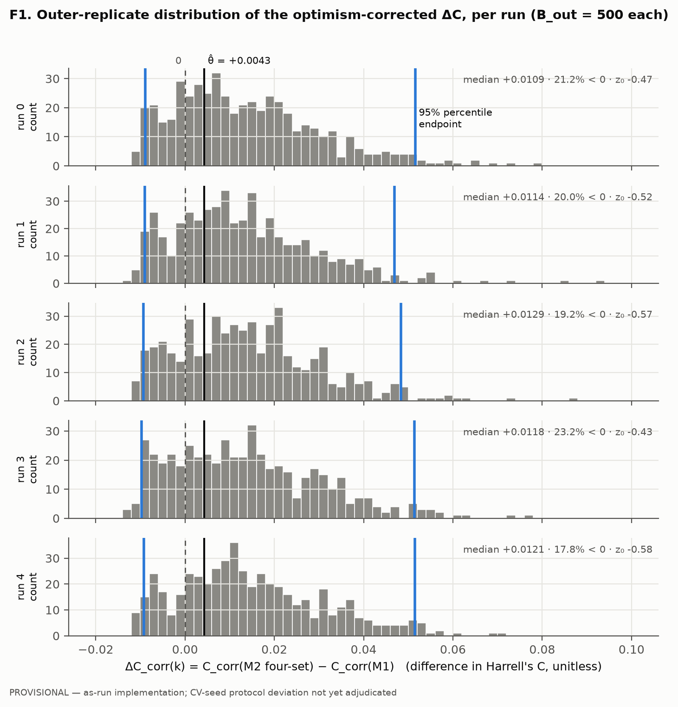
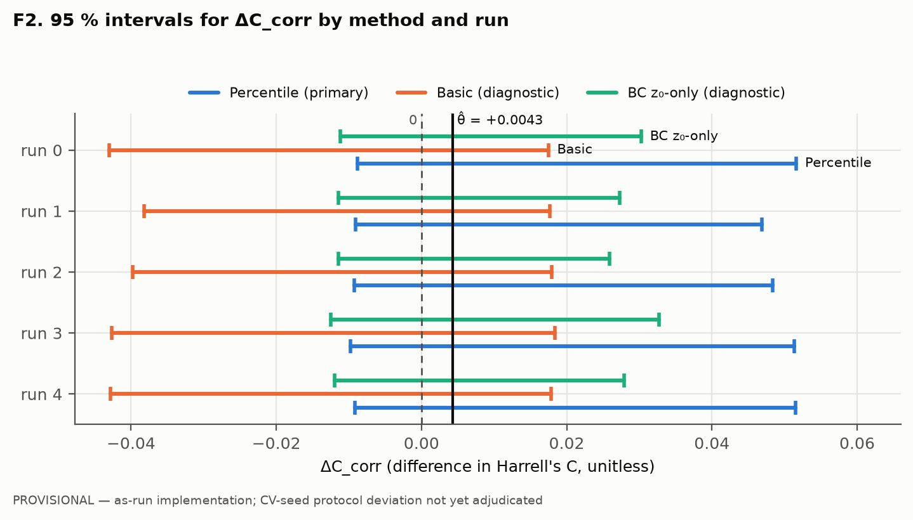
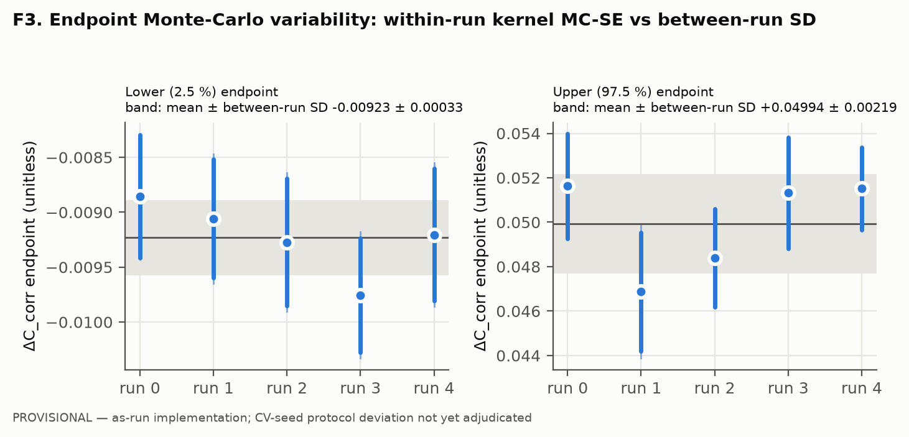
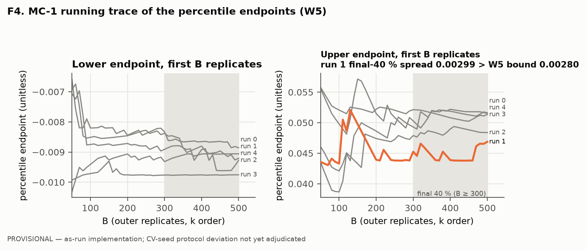
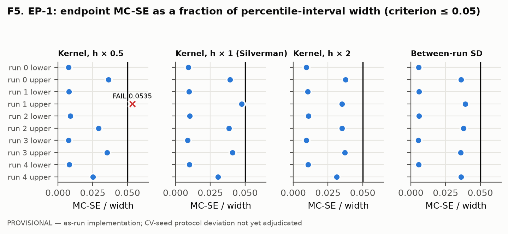
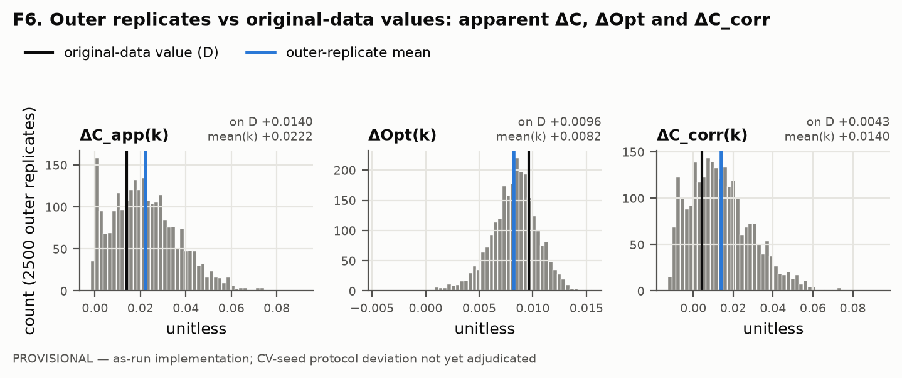

# Phase 9 — Nested-Bootstrap Confidence Interval for the Optimism-Corrected ΔC

**Final research report** · generated {{ R['generated_utc'][:10] }} from `results/s1_interval_results.json` ·
plan `docs/PHASE9_DELTAC_INTERVAL_PLAN.md` v2.1

> **Status of every ΔC_corr-derived result in this report: PROVISIONAL — calculated using the as-run
> implementation; CV-seed protocol deviation not yet adjudicated.**
>
> *Conditional on the observed 136 recurrence events and 316 censored observations in the 452-patient A-19
> population* (mandatory description, plan §4).

---

## 1. Title

Nested-bootstrap 95 % confidence interval for the optimism-corrected difference in Harrell's C between the M2
four-pathway model and the clinical M1 model (Phase 9, median representation, A-19 cohort).

## 2. Executive summary

| Area | Status | Evidence |
|---|---|---|
| Five nested-bootstrap runs (5 × 500 outer × 100 inner; 2 500 outer / 250 000 inner replicates) | **COMPLETE** | §10; checkpoints re-verified (§12) |
| H1: unreliable outer replicates > 5 % | **PASS**: 0 / 2 500 | §11 |
| H2: bounding analysis | **PASS, vacuous**: 0 inner failures, so the bounds equal the primary values | §20 |
| H4: frozen-artifact hashes | **PASS**: 17 / 17 files and 5 / 5 checkpoints unchanged, before and after | §12 |
| H5: reproducibility spot-check | **PASS**: 20 / 20 bit-identical (reproducibility of the **as-run** implementation only) | §13 |
| H6: paired-complete count M1 = M2 | **PASS**: 0 / 2 500 records unequal | §11 |
| CV-seed protocol deviation (plan §8.2 vs driver) | **UNADJUDICATED** | §14; deviation record v2 |
| §9.1 intervals, MC-SE, bounding, between-run SD | **COMPUTED: PROVISIONAL** | §16–§21 |
| EP-1 (MC-SE ≤ 0.05 × width) | **UNRESOLVED**: {{ EP['n_pass'] }} / {{ EP['n_evaluations'] }} evaluations pass; it passes under the named Silverman bandwidth and under the between-run SD, and fails once at bandwidth × 0.5 | §22 |
| H3: EP-1 unmet after exhausting the B_out ladder | **NOT TRIGGERED**: ladder not run | §22 |
| W6 / A7: percentile vs basic divergence > 25 % of width | **BREACH, all 5 runs** | §23 |
| W7 / A8: \|z₀\| > 0.25 | **BREACH, all 5 runs** (z₀ {{ rng(None, "x['z0_diagnostic']['z0']", "+.3f") }}) | §18, §23 |
| W5: MC-1 final-40 % trace spread > EP-1 bound | **BREACH, run 1, upper endpoint** | §23 |
| W1 / W2 / W3 / W4 | no breach | §23 |

**Main numerical result (provisional).**
- The point estimate is θ̂ = **{{ TH['value'] | +.4f }}**, carried forward from Phase 9 primary.
- The five per-run 95 % **percentile** intervals (primary) have lower endpoints {{ rng(None, "x['percentile_primary']['lower']", "+.4f") }} and upper endpoints {{ rng(None, "x['percentile_primary']['upper']", "+.4f") }}. The between-run means are [{{ BR['percentile_lower']['mean'] | +.4f }}, {{ BR['percentile_upper']['mean'] | +.4f }}].
- **Every** run's percentile, basic and bias-corrected (z₀) interval **includes zero.**

**What the diagnostics say.**
- The outer distribution of ΔC_corr(k) is **right-skewed** and **centred well above θ̂**. Its pooled mean is {{ BD['mean_dC_corrected_k'] | +.4f }}, a shift of {{ BD['shift_dC_corrected'] | +.4f }} that is larger than θ̂ itself.
- That shift is why A7 and A8 are breached.
- The plan (§7) says a material percentile-vs-basic divergence "is evidence of skewness or bootstrap bias and a warning that **neither** interval should be trusted".

**What can be concluded.**
- The analysis provides **no evidence** that the M2 four-pathway model improves optimism-corrected discrimination over M1.
- Nor does it establish the *size* of any difference with interval methods whose assumptions are met.

**Completion status.** The project is **computationally complete** but **not methodologically or scientifically complete**. Four decisions remain open (§29):
1. adjudication of the CV-seed deviation;
2. which MC-SE estimator governs EP-1, and with it the B_out top-up;
3. how to report an interval that the plan's A7 / A8 diagnostics flag;
4. whether θ̂ should be re-derived under the nested driver's functional.

## 3. Scientific background

Phase 9 compared a clinical Cox model (M1: age as a restricted cubic spline, sex, TNM stage, tumour location and adjuvant chemotherapy) with the same model plus four frozen pathway scores (M2 four-set; ridge-penalised molecular block, unpenalised clinical block, P6B-A1). The endpoint was relapse-free survival (`rfs_time_full`, `rfs_event_full`) in the A-19 population (n = 452, 136 events), using the median expression representation.

Phase 9 primary estimated:
- ΔC_app(D) = {{ TH['dC_app_D'] | +.4f }};
- ΔOpt(D) = {{ TH['dOpt_D'] | +.4f }} (Harrell bootstrap optimism, 5 seeds × B = 500);
- hence ΔC_corrected = **{{ TH['value'] | +.4f }}**.

**No interval was available for ΔC_corrected** (Phase 9 execution report). The completed runs did not retain the replicate-level arrays, so a nested bootstrap was the only valid way to obtain one (plan §1; `docs/PHASE9_DELTAC_INTERVAL_AUDIT.md`).

## 4. Research question

How precisely is the optimism-corrected ΔC = C_corr(M2 four-set) − C_corr(M1) determined *in a cohort with this event composition*? And does its 95 % interval support a non-zero difference?

## 5. Objectives

1. Compute the plan v2.1 percentile interval (primary) with basic and z₀ diagnostics, per run.
2. Quantify the endpoints' Monte-Carlo error (kernel quantile SE at three bandwidths; between-run SD) separately from sampling uncertainty.
3. Evaluate EP-1, H1–H6 and W1–W7 exactly as written.
4. Verify reproducibility (H5) and document every deviation from the written protocol.

## 6. Computational design

- **Runs:** five independent full-size runs, `run_id` 0–4, B_out = 500, B_in = 100, 8 fork-based workers (plan §5).
- **Fits:** 500 000 in total.
- **Outer level:** each outer replicate is an event-stratified patient bootstrap D*ₖ of D.
- **Apparent fits:** M1 and M2 are fitted on D*ₖ with the full pipeline refitted, giving ΔC_app(k).
- **Inner level:** 100 event-stratified bootstraps of D*ₖ, with optimism evaluated on D*ₖ.
- **Inner failures:** pairing-preserving exclusion.
- **Per replicate:** ΔOpt(k) = mean_b opt(M2) − mean_b opt(M1), and ΔC_corr(k) = ΔC_app(k) − ΔOpt(k) (plan §3.1).

## 7. Data and inputs

| Input | Role | sha256/16 |
|---|---|---|
| `data/processed/analysis/expression_median_S0.parquet` | expression (median representation) | `{{ S0['files_17']['data/processed/analysis/expression_median_S0.parquet']['observed'] }}` |
| `data/processed/analysis/covariates.csv` | clinical covariates | `{{ S0['files_17']['data/processed/analysis/covariates.csv']['observed'] }}` |
| `data/processed/analysis/endpoint.csv` | RFS endpoint | `{{ S0['files_17']['data/processed/analysis/endpoint.csv']['observed'] }}` |
| `data/processed/analysis/cohort_membership.csv` | S3 / A-19 membership | `{{ S0['files_17']['data/processed/analysis/cohort_membership.csv']['observed'] }}` |
| `config/pathways/m2_panel_4set.json` | frozen M2 panel | `{{ S0['files_17']['config/pathways/m2_panel_4set.json']['observed'] }}` |
| `reports/phase9/execution/phase9_execution_results.json` | source of θ̂ | `{{ S0['files_17']['reports/phase9/execution/phase9_execution_results.json']['observed'] }}` |
| `reports/phase9/dc_interval/run{0..4}_outer.jsonl` | the five checkpoints (analysis input) | §12 |

The cohort was originally published as GEO GSE39582 (Marisa et al., 2013).

## 8. Random-seed architecture

- **Base seed:** `BASE = 2026110300`, disjoint from all earlier seeds (plan §8.1).
- **Outer and inner streams:** `SeedSequence([BASE, run_id]).spawn(k+1)[k]` for outer k (equivalent to the plan's `spawn(B_out)[k]`, verified), and `.spawn(B_in)[b]` for inner b.
- **What that guarantees:** runs are independent; within a run, every replicate is a pure function of (BASE, run_id, k, b); resume and scheduling invariance hold.
- **Deviation:** the plan specifies `cvseed = inner[b].spawn(2)[0]` for the λ-tuning CV. The driver instead gives the CV a fresh generator on the *same* seed as the resample (§14).

## 9. Nested-bootstrap methodology

As in §6. Every data-estimated quantity is refitted in every fit, and nothing is cached across layers (plan §3.4):
- age-spline knots;
- gene-level μ/σ (ddof = 1);
- pathway-score standardisation (M2-A2);
- ridge λ by 5-fold CV;
- Cox fit and convergence checks.

The C-index is Harrell's C on `−lp` (lifelines).

## 10. Original five-run execution

| Run | Status | Notes |
|---|---|---|
| 0 | complete | halted at 144 / 500 under the runtime stop condition. Resumed under a **user-authorised exception to the runtime ceiling only** (`RESUME_AUTHORIZATION.json`). Paused in place while the Mac slept (≈ 15:47–18:15, 3 Nov), with no process signalled. Completed 18:31 |
| 1–4 | complete | launched automatically by the original orchestrator; finished 22:55 (run 1), 02:30 (run 2), ≈ 05:50 (run 3), 09:38 (run 4) |

The orchestrator log ends `=== ALL FIVE RUNS COMPLETE ===`. Every run printed `COMPLETE` only after its closing frozen-hash check (H4) passed. Runtimes in the log include sleep time.

## 11. H1 reliability results (and H6, §6.2–6.5 accounting)

{{ TABLE:CKPT }}

- **Failures:** there are 0 inner failures in 250 000 inner replicates, so W1 and W2 do not apply.
- **§6.3:** the representativeness test is **vacuous**, because there are no failed replicates to compare.
- **§6.5:** no outer replicate meets any unreliability criterion, so **H1 is 0 / 2 500**.
- **H6:** paired-complete counts are equal for M1 and M2 in all 2 500 records.

## 12. H4 frozen-artifact verification

The driver's own `check_frozen()` returned **{{ S0['driver_check_frozen'] }}**. The 17-file set gave:

{{ TABLE:HASH17 }}

The verification was run at the start of this work (`results/s0_starting_state.json`) and again in final QC (`audit/final_qc.json`).

## 13. H5 reproducibility validation

The H5 spot-check recomputed run 0 at k = 0, 25, …, 475 with the **frozen driver**. It loaded `outer_replicate` through importlib without calling `main()`, under the same configuration as the original run (`reports/phase9/h5_spotcheck/`).

**Result: {{ H5['n_bit_identical'] }} / 20 bit-identical ΔC_corr (`float.hex`), {{ H5['n_full_record_identical'] }} / 20 identical full records.** These 20 indices span all three execution segments: before the halt, after the first resume, and after the sleep pause.

{{ TABLE:H5 }}

**What H5 establishes:** the as-run implementation is deterministic and resumable.
**What H5 does not establish:** conformance with plan §8.2, or correctness.

## 14. CV-seed protocol deviation

Full record: `documentation/CV_SEED_DEVIATION_DRAFT_v2.md` (**DRAFT — NOT YET ADJUDICATED**). Version 1 is retained at `reports/phase9/h5_spotcheck/`.

- **Plan.** §8.2 line 364 gives the λ-tuning CV its own child stream, `inner[b].spawn(2)[0]`.
- **Driver.** Lines 117 and 142 pass `default_rng(ss_outer)` (apparent fit) and `default_rng(ss_inner[b])` (inner fit). Each starts in **the same PCG64 state** as the generator that drew that fit's bootstrap resample: 9 / 9 cases in `validation/cv_seed_state_evidence.json`, with identical raw outputs. A plan-conformant seed never matches.
- **Affected:** M2 λ selection, and through it every ΔC_corr-derived quantity.
- **Not affected (stored evidence):** M1 apparent λ = 0 in all 2 500 records.
- **Not affected (code path, not measured):** M1 inner λ = 0.
- **θ̂ uses a third convention.** It comes from Phase 9 primary, where the CV draws from one advancing generator after the resample.
- **Not attributed:** the size and direction of any effect are unknown. This report does not attribute any observed feature, including the bias shift in §24, to the deviation.

## 15. Statistical methods

Conventions not fixed by the plan are listed in `documentation/STATISTICAL_CONVENTIONS.md`.

| Quantity | Definition used | Plan reference |
|---|---|---|
| Percentile interval (primary) | [q₀.₀₂₅, q₀.₉₇₅] of the 500 ΔC_corr(k), type-7 quantiles | §3.1, §7 |
| Basic interval (diagnostic) | [2θ̂ − q₀.₉₇₅, 2θ̂ − q₀.₀₂₅] | §7 |
| z₀ (diagnostic) | Φ⁻¹(#{ΔC_corr(k) < θ̂} / 500), strict "<", ties counted separately (there were 0) | §7 |
| BC z₀-only interval (diagnostic) | percentiles at Φ(2z₀ ± 1.96), acceleration 0; BCa excluded | §7; audit line 98 |
| SE(z₀) | √(p(1−p)/B) / φ(z₀) | §7.1 |
| Kernel endpoint MC-SE | √(p(1−p)/B_out) / f̂(q_p), f̂ a Gaussian KDE at the endpoint | §2.2 |
| Bandwidth | Silverman's rule of thumb, 0.9·min(s, IQR/1.34)·n^(−1/5), × {0.5, 1, 2} | §2.2 |
| Between-run endpoint variability | sample SD (ddof = 1, df = 4) of the five endpoints | §2.1 #3, §2.3 |
| EP-1 | MC-SE(endpoint) ≤ 0.05 × (upper − lower), both endpoints; evaluated for **every** prescribed MC-SE estimator | §2 |
| Bounding | missing paired optimism differences imputed at the within-replicate min / max | §6.4 |
| Inner-noise inflation (W3) | mean_k var(d_b)/n_b relative to Var(observed) − that | §1.2 |
| MC-1 trace (W5) | endpoints over the first B ∈ {300, 400, 500} replicates, k order | §11.2; Phase 6B MC-1 |

**Confidence level.** The plan never states the level explicitly. 95 % is used because:
1. Phase 9 primary reports "bootstrap 95 % pct" intervals;
2. the plan's predecessor audit uses the 2.5–97.5 percentile spread;
3. the plan's own arithmetic in §2.2 (expected MC-SE 0.00073 ≈ 3.0 % of width, with a proxy outer SD of 0.0061) implies a width of about 4 SD, i.e. ≈ 2 × 1.96 SD.

## 16. Percentile interval results (primary, PROVISIONAL)

{{ TABLE:T1 }}

## 17. Basic interval results (diagnostic, PROVISIONAL)

The basic interval is the reflection of the percentile interval about θ̂ = {{ TH['value'] | +.5f }}. Because the outer distribution sits mostly above θ̂, the reflection moves it far to the left:
- lower endpoints {{ rng(None, "x['basic_diagnostic']['lower']", "+.4f") }};
- upper endpoints {{ rng(None, "x['basic_diagnostic']['upper']", "+.4f") }}.

At each endpoint it differs from the percentile interval by {{ rng(None, "100*x['warnings']['W6_A7_fraction_of_width']['lower']", ".1f") }} % of the percentile width (the W6 / A7 breach). The two endpoint differences are equal by construction: both equal |q₀.₀₂₅ + q₀.₉₇₅ − 2θ̂|.

## 18. z₀ interval results (diagnostic, PROVISIONAL)

- **z₀ per run:** {{ rng(None, "x['z0_diagnostic']['z0']", "+.3f") }}. Only {{ rng(None, "100*x['z0_diagnostic']['p_less']", ".1f") }} % of outer replicates fall below θ̂.
- **Precision:** SE(z₀) ≈ {{ RUNS[0]['z0_diagnostic']['SE_z0_plan_7_1'] | .3f }} per run (plan §7.1). The pooled z₀ over 2 500 replicates is {{ R['pooled_descriptive']['z0']['z0'] | +.3f }}, with SE {{ R['pooled_descriptive']['z0']['SE_z0_plan_7_1'] | .3f }}.
- **Bias-corrected (z₀-only) intervals:**
  - percentile levels α₁ ≈ {{ RUNS[0]['bc_z0_diagnostic']['alpha1'] | .4f }}, α₂ ≈ {{ RUNS[0]['bc_z0_diagnostic']['alpha2'] | .3f }} (run 0);
  - lower endpoints {{ rng(None, "x['bc_z0_diagnostic']['lower']", "+.4f") }};
  - upper endpoints {{ rng(None, "x['bc_z0_diagnostic']['upper']", "+.4f") }}.
- **Boundary handling:** none needed, since no run had p = 0 or 1.
- **θ̂'s own Monte-Carlo error cannot explain z₀.** θ̂ has MC-SE {{ TH['MC_SE_of_mean'] | .5f }} (SD across the 5 Phase 9 seeds / √5). Moving θ̂ by ± 2 MC-SE changes z₀ by at most {{ max(abs(d['+2SE']-d['+0SE']) for d in R['z0_sensitivity_to_theta_MC_error']['runs'].values()) | .3f }}:

{{ TABLE:T8 }}

## 19. Kernel endpoint MC-SE results (PROVISIONAL)

{{ TABLE:T2 }}

- **Relative to width:**
  - the lower endpoint has a high density and a small MC-SE ({{ rng(None, "x['kernel_MCSE_2_2']['percentile_endpoints']['lower']['bw_x1.0']['SE']", ".5f") }}, {{ rng(None, "100*x['kernel_MCSE_2_2']['percentile_endpoints']['lower']['bw_x1.0']['SE']/x['percentile_primary']['width']", ".1f") }} % of width);
  - the upper endpoint lies in the sparse right tail ({{ rng(None, "x['kernel_MCSE_2_2']['percentile_endpoints']['upper']['bw_x1.0']['SE']", ".5f") }}, {{ rng(None, "100*x['kernel_MCSE_2_2']['percentile_endpoints']['upper']['bw_x1.0']['SE']/x['percentile_primary']['width']", ".1f") }} % of width).
- **Bandwidth sensitivity:** across bandwidth × {0.5, 1, 2}, the kernel MC-SE of a single endpoint varies by up to a factor of {{ max(max(x['kernel_MCSE_2_2']['percentile_endpoints'][e][f'bw_x{m}']['SE'] for m in (0.5,1.0,2.0))/min(x['kernel_MCSE_2_2']['percentile_endpoints'][e][f'bw_x{m}']['SE'] for m in (0.5,1.0,2.0)) for x in RUNS for e in ('lower','upper')) | .2f }}. This is the plan's stated reason for reporting three bandwidths.
- **Cross-check:** the scipy "Silverman" variant (1.06 σ n^(−1/5)) is given for comparison only.
- **Agreement with the between-run SD:** kernel and between-run estimates agree within 2× for every run and endpoint, so W4 is not breached. Agreement is *consistency*, not validation (plan §2.3).

## 20. Bounding analysis (§6.4)

- **Status:** **vacuous.** No outer replicate has a missing paired inner replicate (0 failures), so ΔC_corr^min(k) = ΔC_corr^max(k) = ΔC_corr(k) for every k, and both bounded intervals equal the primary interval.
- **Endpoint movement:** 0. It is therefore below every endpoint MC-SE, so **H2 is not breached**.
- **§6.5 criterion 3** (bounding width > MC-SE) is met by no replicate.
- **Testing:** the imputation code is unit-tested on synthetic replicates with missing pairs (`validation/tests/test_stats_core.py`).

## 21. Across-run variability

{{ TABLE:T3 }}

- **Precision of the SD estimates:** each SD rests on 5 values (df = 4), so its relative SE is about 35 % (plan §2.3).
- **Spread:** the upper percentile endpoint varies about {{ BR['percentile_upper']['sd_ddof1'] / BR['percentile_lower']['sd_ddof1'] | .1f }}× more between runs than the lower endpoint.
- **Scope:** these SDs bound Monte-Carlo variability only. They do not bound any systematic error that all five runs share.

## 22. EP-1 evaluation

**Criterion (plan §2, approved decision 1):** MC-SE(endpoint) ≤ 0.05 × (upper − lower), for **both** endpoints, on the percentile interval of each run. The plan prescribes two MC-SE estimators: kernel at Silverman × {0.5, 1, 2} (§2.2) and the between-run SD (§2.1 #3). **It does not say which governs**, so all four are evaluated.

{{ TABLE:T4 }}

The only failing evaluation is **run 1, upper endpoint, kernel at bandwidth × 0.5**. Its MC-SE / width is {{ EP['max_ratio_case']['ratio'] | .4f }}, against a bound of 0.05. At the Silverman bandwidth itself the same endpoint gives {{ [g for g in EP['grid'] if g['run']==1 and g['endpoint']=='upper' and g['estimator']=='kernel_bw_x1.0'][0]['ratio'] | .4f }}.

**EP-1 status: UNRESOLVED, decision required.**
- **What it shows:** under the plan's named bandwidth and under the between-run SD, every endpoint of every run meets EP-1.
- **If every prescribed estimator must pass:** EP-1 fails narrowly. Plan §2.4 would then require a top-up to B_out′ = 500 × ({{ EP['max_ratio'] | .4f }} / 0.05)² = {{ EP['plan_2_4_ladder_if_strict']['required_B_out'] | .0f }}, i.e. ladder rung **{{ EP['plan_2_4_ladder_if_strict']['ladder_rung'] }}**.
- **Why the top-up was not run:** it is a resource and scientific decision, and it would add records to the run checkpoints. **The threshold was not relaxed.**
- **Overlap with W5:** run 1's upper-endpoint W5 breach (§23) points the same way. The plan's consequence for W5 is "raise B_out".
- **What EP-1 does not establish:** EP-1 concerns Monte-Carlo precision only. Even a clean pass would say nothing about the validity of the interval, which is the subject of the A7 / A8 diagnostics.

The full 40-row grid:

{{ TABLE:T4b }}

## 23. Robustness findings: hard-failure and warning inventory

{{ TABLE:T5 }}

| Plan item | Required analysis | Status |
|---|---|---|
| §2.2 bandwidth × {0.5, 1, 2} | kernel MC-SE sensitivity | done (§19) |
| §2.1 #3, §2.3 | between-run endpoint SD | done (§21) |
| §6.3 | failed-vs-successful representativeness | **NOT APPLICABLE**: 0 failures |
| §6.4 / H2 | bounding analysis | done; vacuous (§20) |
| §6.5 / H1 | unreliable outer replicates | done; 0 (§11) |
| §1.2 / W3 | inner-noise SD inflation | done; {{ rng(None, "100*x['warnings']['W3_SD_inflation']", ".2f") }} % (plan's sizing anticipated ≈ 1.2 %) |
| W4 | kernel vs between-run, > 2× | done; no breach |
| W5 / MC-1 | running-trace spread, final 40 % | done; **breach in run 1 (upper)** |
| W6 / A7 | percentile vs basic | done; **breach in all runs** |
| W7 / A8 | \|z₀\| > 0.25 | done; **breach in all runs** |
| §2.4 | B_out ladder top-up if EP-1 fails | **BLOCKED**: EP-1 governing estimator undecided; top-up not authorised |
| S-7 representation | nested interval for S-7 | **NOT APPLICABLE**: plan v2.1 specifies the median representation only; S-7 is sensitivity-only for the point estimate |
| CV-seed sensitivity recomputation | alternative seeding | **NOT AUTHORISED**: listed for adjudication only |

## 24. Scientific interpretation

### 24.1 Observed results

- **The estimand.** ΔC_corr is a difference in Harrell's C between two optimism-corrected models. A positive value means M2 ranks relapse risk better than M1 after optimism correction.
- **The outer distribution:**
  - per-run medians {{ rng(None, "x['distribution']['dC_corrected']['median']", "+.4f") }};
  - means {{ rng(None, "x['distribution']['dC_corrected']['mean']", "+.4f") }};
  - SD {{ rng(None, "x['distribution']['dC_corrected']['sd']", ".4f") }};
  - right skew {{ rng(None, "x['distribution']['dC_corrected']['skewness']", ".2f") }};
  - {{ rng(None, "100*x['distribution']['dC_corrected']['frac_negative']", ".1f") }} % of replicates below zero.
- **All 15 intervals include zero:** 5 runs × 3 methods.
- **Decomposition:**

  {{ TABLE:T7 }}

  The outer mean of ΔC_corr(k) exceeds θ̂ by {{ BD['shift_dC_corrected'] | +.4f }}. Of that:
  - {{ BD['shift_dC_app'] | +.4f }} comes from a larger apparent ΔC on D*ₖ;
  - {{ -BD['shift_dOpt'] | +.4f }} comes from a smaller ΔOpt within D*ₖ.

{{ TABLE:T6 }}

### 24.2 Supported conclusions

1. At the reported Monte-Carlo precision, **the 95 % interval for ΔC_corr is compatible with zero under every interval method and every run.** The data do not support a claim that the four pathway scores improve optimism-corrected discrimination over the clinical model. That conclusion does not depend on which interval method is chosen, or on the A7 / A8 outcome.
2. **The bootstrap distribution is not centred on θ̂.** |z₀| = {{ rng(None, "abs(x['z0_diagnostic']['z0'])", ".2f") }} is {{ rng(None, "abs(x['z0_diagnostic']['z0'])/x['z0_diagnostic']['SE_z0_plan_7_1']", ".1f") }} SE(z₀) from 0, and θ̂'s own Monte-Carlo error can't account for it. The plan's diagnostic for this (A8) fires in every run.
3. **Method choice changes the *location and upper limit* of the interval substantially:**
   - percentile upper ≈ {{ BR['percentile_upper']['mean'] | +.3f }};
   - basic upper ≈ {{ BR['basic_upper']['mean'] | +.3f }};
   - BC upper ≈ {{ BR['bc_z0_upper']['mean'] | +.3f }}.

   Under plan §7, a divergence this large is "a warning that neither interval should be trusted". **No method is preferred here because of its result.**
4. **Endpoint Monte-Carlo error is small next to sampling uncertainty.** at the Silverman bandwidth, MC-SE is {{ 100*min(g['ratio'] for g in EP['grid'] if g['estimator']=='kernel_bw_x1.0') | .1f }}–{{ 100*max(g['ratio'] for g in EP['grid'] if g['estimator']=='kernel_bw_x1.0') | .1f }} % of the interval width, and inner-noise inflation of the outer SD is {{ rng(None, "100*x['warnings']['W3_SD_inflation']", ".2f") }} %. Numerical precision is not what limits the conclusions.

### 24.3 Plausible explanations (inferential, not tested here)

- **A larger apparent ΔC on bootstrap samples.** On D*ₖ, {{ 100*(1-RUNS[0]['distribution']['n_distinct_outer']['mean']/452) | .1f }} % of rows duplicate other rows, which plausibly favours the more flexible M2 (four penalised scores) in apparent C.
- **A smaller inner ΔOpt.** The inner optimism is evaluated on D*ₖ, which shares most of its patients with each inner sample. That could make the estimated optimism *smaller* than on D.
- **Plan §7.2 predicted the opposite.** It expected the outer distribution to sit *below* θ̂, because inner optimism would be larger. The observed direction is the reverse. Note also that §7.2 says a distribution below θ̂ would give a *negative* z₀, which is inconsistent with §7's own definition (a distribution below θ̂ gives z₀ > 0). The observed z₀ is negative because the distribution sits *above* θ̂.
- **θ̂ and the outer replicates come from different implementations.** θ̂ is the Phase 9 primary estimate (different seeding, §14), not the frozen nested driver applied to D. How comparable they are is unverified.
- **The CV-seed deviation is not offered as an explanation.** No evidence links it to the shift.

### 24.4 Unresolved questions

1. Adjudication of the CV-seed deviation (record v2, §10).
2. Which MC-SE estimator governs EP-1, and so whether the §2.4 top-up (to B_out = {{ EP['plan_2_4_ladder_if_strict']['ladder_rung'] }}) is required. Also how to act on the run-1 W5 breach.
3. How to report an interval when A7 and A8 both fire in every run: which interval, if any, is presented as *the* result, and with what qualification. The plan doesn't designate a single headline interval across the five runs.
4. Whether θ̂ from Phase 9 primary is the right centring value for the basic interval and z₀, or whether the frozen driver's functional should be evaluated on D. That evaluation would be a new computation and is not authorised.

## 25. Limitations

- **This analysis:**
  - the CV-seed protocol deviation (unadjudicated);
  - θ̂ produced under a different seeding convention;
  - EP-1's governing estimator unspecified;
  - the run-1 W5 breach;
  - the A7 / A8 breaches;
  - conventions adopted where the plan is silent (95 % level, Silverman 1986 rule, type-7 quantiles).
- **Standing limitations (plan §13–14), unchanged:**
  - conditional on 136 events;
  - bootstrap validity asymptotic at n = 452;
  - distinct-patient dilution (≈ {{ RUNS[0]['distribution']['n_distinct_outer']['mean'] | .0f }} of 452 distinct per outer sample);
  - between-run SD on df = 4;
  - A7 has no statistical justification and A8 is a loose detector;
  - no deconvolution of inner noise;
  - Harrell's C depends on the censoring distribution;
  - asymmetric penalisation (P6B-A1) makes the comparison conservative by design;
  - internal validation only; U1 unresolved.
- **What the interval can't establish:** it quantifies uncertainty and nothing more. It establishes **no clinical utility, biological mechanism, external validity or transportability.**

## 26. Reproducibility instructions

See `reproducibility/README_REPRODUCE.md`. In summary: `reproducibility/run_all.sh` runs stages S0 → S3, the independent check, the tests and final QC, writing only inside `reports/phase9/final_project/`. Outputs are deterministic given the five checkpoints. No stage re-runs the bootstrap.

## 27. Software and environment

| | |
|---|---|
| Python | {{ ENV['python_version'] }} |
| Platform | {{ ENV['platform'] }} |
| numpy / scipy / pandas / lifelines / matplotlib | {{ ENV['packages'].get('numpy','?') }} / {{ ENV['packages'].get('scipy','?') }} / {{ ENV['packages'].get('pandas','?') }} / {{ ENV['packages'].get('lifelines','?') }} / {{ ENV['packages'].get('matplotlib','?') }} |

The full capture is in `reproducibility/environment.json`. No dependency was installed or upgraded.

## 28. Audit trail

The project-level record is `audit/EXECUTION_LEDGER.md` (every task, command, test, error and disposition), with run logs in `audit/`. The earlier records are retained unchanged: `HALT_RECORD.json`, `RESUME_AUTHORIZATION.json`, `resume_driver.log`, `reports/phase9/h5_spotcheck/*`.

Two corrections were made during this work and are preserved in `audit/`:
1. the H3 flag was wrongly set when EP-1 was mixed;
2. figure label collisions.

## 29. Conclusions

1. **Computation is complete and verified.** 5 × 500 × 100 replicates; H1, H2, H4, H5 and H6 pass; 0 inner failures; {{ IC['n_ok'] }} / {{ IC['n_checks'] }} independent re-computation checks agree.
2. **Provisional statistical result.** Every 95 % interval for the optimism-corrected ΔC includes zero. The primary percentile interval averages [{{ BR['percentile_lower']['mean'] | +.4f }}, {{ BR['percentile_upper']['mean'] | +.4f }}] across runs. The analysis does **not** support an improvement of M2 over M1.
3. **Interval validity is in question by the plan's own diagnostics.** A7 and A8 breach in every run: the bootstrap distribution sits well above θ̂ and is right-skewed. No interval should be quoted without that qualification.
4. **Open decisions:**
   - (a) CV-seed deviation;
   - (b) EP-1 governing estimator, and with it the §2.4 / W5 B_out top-up;
   - (c) how to report an interval that the plan's diagnostics flag;
   - (d) whether θ̂ should be re-derived under the nested driver's functional.

   Until these are settled, the project is **computationally complete but methodologically and scientifically provisional.**

## 30. References

1. Efron B, Tibshirani RJ. *An Introduction to the Bootstrap.* Chapman & Hall, 1993.
2. Davison AC, Hinkley DV. *Bootstrap Methods and their Application.* Cambridge University Press, 1997.
3. Efron B. Better bootstrap confidence intervals. *J Am Stat Assoc* 1987;82:171–185.
4. Harrell FE, Lee KL, Mark DB. Multivariable prognostic models: issues in developing models, evaluating assumptions and adequacy, and measuring and reducing errors. *Stat Med* 1996;15:361–387.
5. Steyerberg EW. *Clinical Prediction Models*, 2nd ed. Springer, 2019.
6. Silverman BW. *Density Estimation for Statistics and Data Analysis.* Chapman & Hall, 1986.
7. Hyndman RJ, Fan Y. Sample quantiles in statistical packages. *Am Stat* 1996;50:361–365.
8. van der Vaart AW. *Asymptotic Statistics.* Cambridge University Press, 1998 (asymptotic variance of sample quantiles).
9. Davidson-Pilon C. lifelines: survival analysis in Python. *J Open Source Softw* 2019;4(40):1317.
10. Marisa L, et al. Gene expression classification of colon cancer into molecular subtypes: characterization, validation, and prognostic value. *PLoS Med* 2013;10(5):e1001453.
11. Project documents: `docs/PHASE9_DELTAC_INTERVAL_PLAN.md` v2.1; `docs/PHASE9_DELTAC_INTERVAL_AUDIT.md`; `docs/PHASE9_EXECUTION_REPORT.md`; `docs/PHASE6B_MODELING_PROTOCOL_DRAFT.md` (MC-1…MC-4).

---

### Figures

Captions: `figures/FIGURE_CAPTIONS.md`. Every figure is generated by `analysis/s2_figures.py` from `results/s1_interval_results.json`.
